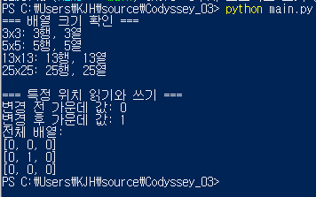

# Mini NPU Simulator

숫자로 표현한 그림을 필터와 비교하여 십자가(Cross)인지 X인지 판정하는
Python 콘솔 프로그램입니다.

같은 위치의 숫자끼리 곱하고 그 결과를 더하는 MAC 연산을 직접 구현합니다.
실제 NPU 하드웨어의 병렬 실행을 재현하는 것은 아니며,
NPU에서 중요한 MAC 계산 원리를 학습하는 프로젝트입니다.

## 1. 프로젝트 목표

- 2차원 배열로 패턴과 필터를 저장하고 특정 위치의 값을 읽고 수정한다.
- 반복문으로 MAC 연산을 구현하고 계산 원리를 설명한다.
- JSON의 키와 라벨 규칙을 해석하고 라벨을 표준화한다.
- 허용오차를 사용해 부동소수점 점수를 비교한다.
- 크기별 계산 시간을 측정하고 시간 복잡도 O(N²)를 설명한다.
- 실패 원인을 데이터·스키마, 계산 로직, 수치 비교 문제로 구분한다.

## 2. 개발 환경

- 운영체제: Windows
- 터미널: PowerShell
- Python: 3.13.17
- 버전 관리: Git / GitHub
- 외부 라이브러리 없이 Python 표준 라이브러리만 사용

## 3. 구현 현황

### 필수 기능

- [ ] 3×3, 5×5, 13×13, 25×25 배열 처리
- [x] 배열의 특정 위치 읽기와 쓰기
- [ ] 3×3 필터 A·B 입력 및 저장 확인, 패턴 입력
- [ ] 입력 형식 오류 안내 및 재입력
- [x] 반복문 기반 MAC 연산
- [ ] epsilon 기반 A/B/판정 불가 처리
- [ ] data.json 로드와 키 규칙·배열 크기 검증
- [ ] Cross/X 라벨 정규화
- [ ] 케이스별 점수·판정·expected·PASS/FAIL 출력
- [ ] 오류 케이스를 FAIL로 기록하고 나머지 분석 계속 진행
- [ ] 크기별 10회 이상 평균 시간 및 N² 표 출력
- [ ] 전체·통과·실패 수와 실패 사유 요약
- [ ] 요구된 순서에 따른 두 모드 실행

### 보너스 기능

- [ ] 크기 N에 따른 십자가와 X 패턴 자동 생성
- [ ] 생성한 패턴을 사용자 입력 모드와 성능 분석에 재사용
- [ ] 2차원 배열을 1차원 배열로 변환하여 MAC 계산
- [ ] 동일 입력·동일 반복 횟수로 두 방식의 결과와 성능 비교

## 4. 파일 구성

현재 준비된 파일:
- README.md: 프로젝트 설명과 학습·검증 기록
- data.json: 미션에서 제공한 필터와 패턴 데이터
- .gitignore: Git 기록에서 제외할 파일 설정
- main.py: 배열 생성, 반복문 기반 MAC 연산, 개발 단계의 실행 확인 코드

구현을 진행하면서 실제 파일 구성에 맞게 갱신한다.

## 5. 실행 방법

프로그램 실행 기능 구현 후 실제로 확인한 명령과 입력 예시를 작성한다.

## 6. 핵심 개념과 구현 설명

MAC, 2차원 배열, 라벨 정규화, epsilon을 학습할 때마다
간단한 예시와 해당 코드의 역할을 기록한다.

### 2차원 배열: 숫자로 된 그림 저장하기

패턴과 필터는 Python의 리스트 안에 리스트를 넣는 방식으로 저장한다.
바깥 리스트는 전체 표이고, 안쪽 리스트 하나는 가로 한 줄인 행이다.

make_matrix(n)은 n행 n열의 표를 만들고 모든 칸을 0으로 채운다.
각 행을 새로운 리스트로 만들기 때문에 한 행을 수정해도 다른 행은 바뀌지 않는다.

Python의 위치 번호는 0부터 시작한다.
따라서 matrix[1][1]은 두 번째 행의 두 번째 칸이다.
matrix[1][1] = 1은 그 칸에 1을 저장하고,
print(matrix[1][1])은 저장한 값을 읽어 화면에 표시한다.

### MAC 연산: 같은 위치끼리 곱하고 더하기

MAC는 Multiply-Accumulate의 약자로, 두 숫자를 곱한 값을 합계에 누적하는 연산이다.
이 프로그램에서는 입력 패턴과 필터의 같은 위치에 있는 숫자끼리 곱하고,
모든 칸의 계산 결과를 더해 점수를 구한다.

mac(pattern, filt) 함수는 이중 for문으로 행과 열을 차례로 방문한다.
total은 합계를 저장하는 변수이며, 0.0에서 시작해 각 칸의 곱을 더한다.
외부 라이브러리 없이 Python 반복문으로 직접 구현했다.

3×3 배열에서는 필터 하나당 9번의 MAC 연산을 수행한다.
십자가 입력을 십자가 필터와 비교하면 5점, X 필터와 비교하면 1점이다.
이 예시에서는 같은 모양의 필터가 더 높은 점수를 얻는다.

이 점수는 일치한 칸의 개수나 확률이 아니다.
예를 들어 두 칸이 모두 0이어도 0×0의 계산 결과는 0점이다.

## 7. 실행 결과와 오류 처리 검증

정상 입력, 잘못된 입력, JSON 분석, 동점 처리 결과를 기록한다.
각 기록에는 실행 방법, 예상 결과, 실제 결과를 함께 작성한다.

### 배열 생성 및 특정 위치 읽기·쓰기 검증

- 검증 목적: 필요한 크기의 배열을 만들고 특정 칸을 읽고 수정할 수 있는지 확인한다.
- 실행 방법: 배열 확인 기능을 작성한 단계에서 `python main.py`를 실행했다.
- 실제 결과: 3×3, 5×5, 13×13, 25×25 배열의 행과 열 수가 각각 일치했다.
- 실제 결과: 3×3 배열의 가운데 값을 읽으면 0이었으며, 수정 후에는 1이었다.
- 실제 결과: 가운데 칸 이외의 칸은 모두 0을 유지했다.
- 해석: 필요한 크기의 배열 생성과 특정 위치 읽기·쓰기가 정상 동작했다.

이 기록은 개발 중 배열 기능을 확인한 결과이며,
완성된 프로그램의 사용 방법은 '실행 방법' 절에 별도로 정리한다.

### MAC 연산 검증

- 검증 목적: 같은 위치끼리 곱하고 더한 결과가 손으로 계산한 값과 같은지 확인한다.
- 실행 방법: MAC 확인 기능을 추가한 단계에서 `python main.py`를 실행했다.

| 입력 패턴 | 비교 필터 | 예상 점수 | 실제 점수 |
|---|---|---:|---:|
| 십자가 | 십자가 | 5.0 | 5.0 |
| 십자가 | X | 1.0 | 1.0 |
| X | 십자가 | 1.0 | 1.0 |
| X | X | 5.0 | 5.0 |

네 가지 계산 결과가 모두 예상값과 일치했다.
현재는 점수 계산까지 확인했으며, 점수 비교와 동점 판정은 다음 단계에서 구현한다.

## 8. 결과 리포트

프로그램 완성 후 실제 실행 결과를 바탕으로
실패 원인 분석과 시간 복잡도 분석을 합쳐 10줄 이상 작성한다.

### 전체 결과와 실패 원인

### 성능 측정 결과와 O(N²) 분석

## 9. 보너스 구현과 비교 결과

### 패턴 자동 생성

### 2차원·1차원 MAC 비교