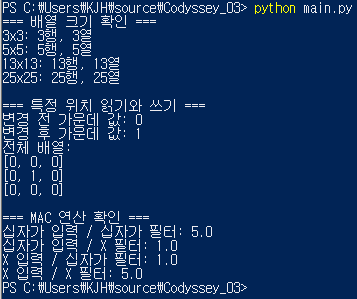
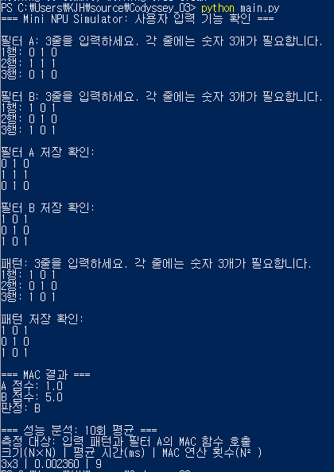
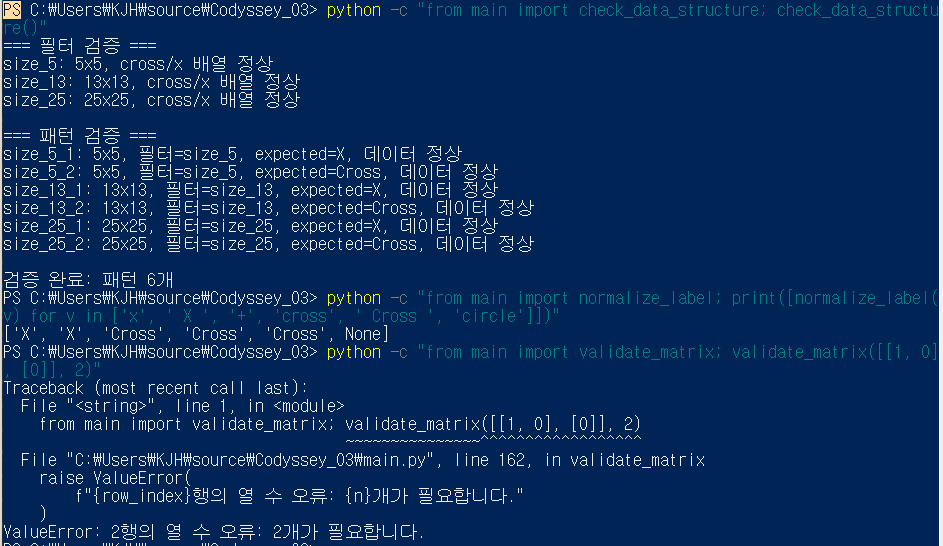
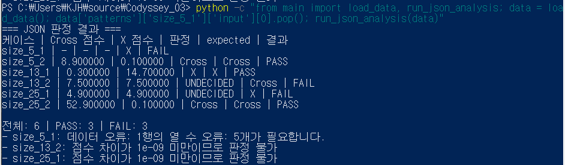
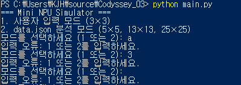
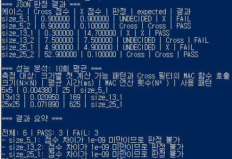
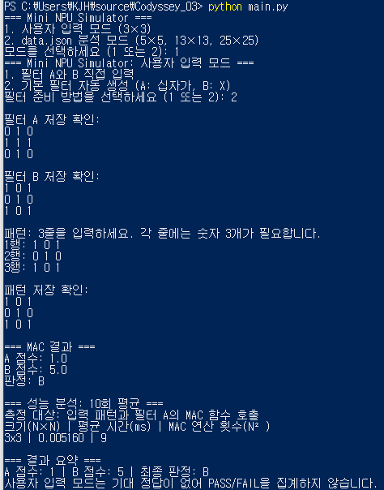
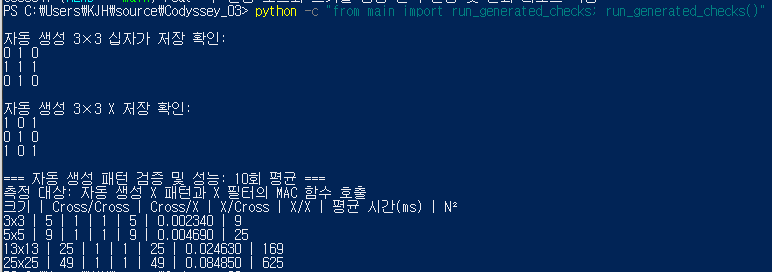

# Mini NPU Simulator

숫자로 표현한 그림을 필터와 비교하여 십자가(Cross)인지 X인지 판정하는
Python 콘솔 프로그램입니다.

같은 위치의 숫자끼리 곱하고 그 결과를 더하는 MAC 연산을 직접 구현합니다.
실제 NPU 하드웨어의 병렬 실행을 재현하는 것은 아니며,
NPU에서 중요한 MAC 계산 원리를 학습하는 프로젝트입니다.

## 1. 프로젝트 목표

- 2차원 배열로 패턴과 필터를 저장하고 특정 위치의 값을 읽고 수정한다.
- 반복문으로 MAC 연산을 구현하고 계산 원리를 설명한다.
- JSON의 키와 라벨 규칙을 해석하고 라벨을 표준화한다.
- 허용오차를 사용해 부동소수점 점수를 비교한다.
- 크기별 계산 시간을 측정하고 시간 복잡도 O(N²)를 설명한다.
- 실패 원인을 데이터·스키마, 계산 로직, 수치 비교 문제로 구분한다.

## 2. 개발 환경

- 운영체제: Windows
- 터미널: PowerShell
- Python: 3.13.17
- 버전 관리: Git / GitHub
- 외부 라이브러리 없이 Python 표준 라이브러리만 사용

## 3. 구현 현황

### 필수 기능

- [x] 3×3, 5×5, 13×13, 25×25 배열 처리
- [x] 배열의 특정 위치 읽기와 쓰기
- [x] 3×3 필터 A·B 입력 및 저장 확인, 패턴 입력
- [x] 입력 형식 오류 안내 및 재입력
- [x] 반복문 기반 MAC 연산
- [x] epsilon 기반 A/B/판정 불가 처리
- [x] data.json 로드와 키 규칙·배열 크기 검증
- [x] Cross/X 라벨 정규화
- [x] 케이스별 점수·판정·expected·PASS/FAIL 출력
- [x] 오류 케이스를 FAIL로 기록하고 나머지 분석 계속 진행
- [x] 크기별 10회 이상 평균 시간 및 N² 표 출력
- [x] 전체·통과·실패 수와 실패 사유 요약
- [x] 요구된 순서에 따른 두 모드 실행

### 보너스 기능

- [x] 크기 N에 따른 십자가와 X 패턴 자동 생성
- [x] 생성한 패턴을 사용자 입력 모드와 성능 분석에 재사용
- [ ] 2차원 배열을 1차원 배열로 변환하여 MAC 계산
- [ ] 동일 입력·동일 반복 횟수로 두 방식의 결과와 성능 비교

## 4. 파일 구성

| 파일 또는 폴더 | 역할 |
|---|---|
| main.py | 모드 선택, 입력 검증, JSON 로드, MAC 계산, 판정, 성능 측정, 결과 요약 |
| data.json | 미션에서 제공한 크기별 필터와 패턴, 기대 정답 |
| README.md | 프로젝트 설명, 실행 방법, 검증 기록, 결과 리포트 |
| docs/images/ | 개발 과정과 실행 결과 캡처 |
| .gitignore | Python 캐시와 가상환경 등을 Git 기록에서 제외 |

외부 라이브러리 없이 Python 표준 라이브러리만 사용한다.

## 5. 실행 방법

main.py와 data.json을 같은 폴더에 둔다.
PowerShell에서 프로젝트 폴더로 이동한 다음 실행한다.

```powershell
cd C:\Users\KJH\source\Codyssey_03
python main.py
```

### 모드 1: 사용자 입력

메뉴에서 1을 선택한 뒤 필터 준비 방법을 선택한다.

- 1: 필터 A와 B를 직접 입력한다.
- 2: 필터 A는 십자가, 필터 B는 X로 자동 생성한다.

직접 입력을 선택하면 필터 A, 필터 B, 입력 패턴 순서로 각각 3행을 입력한다.
자동 생성을 선택하면 필터 저장 내용을 확인한 뒤 입력 패턴만 3행 입력한다.
각 행은 숫자 3개를 공백으로 구분한다.
아래 표는 필터를 직접 입력할 때의 예시이다.

| 입력 대상 | 1행 | 2행 | 3행 |
|---|---|---|---|
| 필터 A | 0 1 0 | 1 1 1 | 0 1 0 |
| 필터 B | 1 0 1 | 0 1 0 | 1 0 1 |
| 입력 패턴 | 1 0 1 | 0 1 0 | 1 0 1 |

위 예시에서는 A 점수 1.0, B 점수 5.0으로 B가 선택된다.
판정 뒤에 3×3 MAC 평균 계산 시간과 결과 요약을 출력한다.
기대 정답을 입력받지 않으므로 이 모드에서는 PASS/FAIL을 집계하지 않는다.

### 모드 2: JSON 분석

메뉴에서 2를 선택한다.
프로그램은 main.py의 위치를 기준으로 data.json을 찾아 읽는다.

패턴별 Cross/X 점수, 판정, 기대 정답, PASS/FAIL을 출력한다.
이어서 5×5, 13×13, 25×25 성능 표와 전체 결과 요약을 출력한다.
제공된 데이터의 예상 집계는 전체 6개, PASS 3개, FAIL 3개이다.
세 FAIL은 점수가 동점이어서 UNDECIDED가 된 경우이다.

### 입력 오류와 실행 흐름

메뉴에서 1 또는 2 이외의 값을 입력하면 다시 선택하도록 안내한다.
사용자 입력의 숫자 개수나 형식이 잘못되면 해당 행만 다시 입력받는다.
JSON 케이스에 데이터 오류가 있으면 실패 사유를 기록하고 다음 케이스를 처리한다.
파일을 읽을 수 없거나 최상위 구조가 잘못되면 분석 시작 실패를 안내한다.

실행 순서는 모드 선택 → 입력 또는 로드 → MAC 계산 → 판정 →
성능 분석 → 결과 요약이다.
선택한 모드를 한 번 실행한 뒤 종료하며, 다른 모드는 다시 실행하여 선택한다.

## 6. 핵심 개념과 구현 설명

MAC, 2차원 배열, 라벨 정규화, epsilon을 학습할 때마다
간단한 예시와 해당 코드의 역할을 기록한다.

### 2차원 배열: 숫자로 된 그림 저장하기

패턴과 필터는 Python의 리스트 안에 리스트를 넣는 방식으로 저장한다.
바깥 리스트는 전체 표이고, 안쪽 리스트 하나는 가로 한 줄인 행이다.

make_matrix(n)은 n행 n열의 표를 만들고 모든 칸을 0으로 채운다.
각 행을 새로운 리스트로 만들기 때문에 한 행을 수정해도 다른 행은 바뀌지 않는다.

Python의 위치 번호는 0부터 시작한다.
따라서 matrix[1][1]은 두 번째 행의 두 번째 칸이다.
matrix[1][1] = 1은 그 칸에 1을 저장하고,
print(matrix[1][1])은 저장한 값을 읽어 화면에 표시한다.

### MAC 연산: 같은 위치끼리 곱하고 더하기

MAC는 Multiply-Accumulate의 약자로, 두 숫자를 곱한 값을 합계에 누적하는 연산이다.
이 프로그램에서는 입력 패턴과 필터의 같은 위치에 있는 숫자끼리 곱하고,
모든 칸의 계산 결과를 더해 점수를 구한다.

mac(pattern, filt) 함수는 이중 for문으로 행과 열을 차례로 방문한다.
total은 합계를 저장하는 변수이며, 0.0에서 시작해 각 칸의 곱을 더한다.
외부 라이브러리 없이 Python 반복문으로 직접 구현했다.

3×3 배열에서는 필터 하나당 9번의 MAC 연산을 수행한다.
십자가 입력을 십자가 필터와 비교하면 5점, X 필터와 비교하면 1점이다.
이 예시에서는 같은 모양의 필터가 더 높은 점수를 얻는다.

이 점수는 일치한 칸의 개수나 확률이 아니다.
예를 들어 두 칸이 모두 0이어도 0×0의 계산 결과는 0점이다.

### 사용자 입력과 입력 검증

read_matrix()는 한 줄을 입력받아 공백으로 나누고 숫자로 변환한다.
각 줄에 숫자가 정확히 3개 있는지 확인하며, 올바른 행 3개를 저장한다.
공백 없이 입력한 010은 세 칸이 아니라 하나의 항목으로 처리된다.

숫자 개수가 틀리거나 문자가 들어오면 안내 문구를 출력하고 같은 행을 다시 입력받는다.
검사에 통과한 행만 배열에 추가하므로 잘못된 입력은 계산에 포함되지 않는다.
이미 올바르게 입력한 앞의 행은 유지한다.

필터 A와 B를 입력한 뒤 저장 내용을 표시하고, 이어서 패턴을 입력받는다.
입력과 검증은 read_matrix(), 점수 계산은 mac()이 담당한다.

### 부동소수점 오차와 epsilon 판정

컴퓨터는 일부 소수를 정확하게 표현하지 못한다.
예를 들어 Python에서 0.1 + 0.2는 0.30000000000000004로 계산된다.
이 값을 0.3과 그대로 비교하면 아주 작은 차이 때문에 한쪽이 더 크다고 판단한다.

이 프로그램은 EPSILON = 1e-9를 기준으로 사용한다.
abs(score_a - score_b) < EPSILON이면 동점으로 보고 UNDECIDED를 반환한다.
사용자 입력 화면에서는 UNDECIDED를 '판정 불가'로 표시한다.
동점이 아니면 점수가 더 큰 필터를 선택한다.

epsilon은 계산 오차를 없애는 기능이 아니라 작은 차이를 판단하는 기준이다.
차이가 epsilon과 정확히 같으면 동점이 아니다.

### MAC 계산 시간 측정

time.perf_counter()로 mac() 함수 호출 직전과 직후의 시각을 기록한다.
두 시각의 차이를 10회 누적한 뒤 10으로 나누어 평균을 구한다.
초 단위 결과에 1000을 곱해 밀리초(ms)로 표시한다.

측정 대상은 입력 패턴과 필터 하나의 MAC 계산이다.
사용자 입력, 화면 출력, 판정 시간은 측정 구간에서 제외한다.
N×N 배열에서 필터 하나를 계산할 때 MAC 연산 횟수는 N²이다.

실행 환경과 컴퓨터 상태에 따라 측정 시간은 달라질 수 있다.

## 7. 실행 결과와 오류 처리 검증

정상 입력, 잘못된 입력, JSON 분석, 동점 처리 결과를 기록한다.
각 기록에는 실행 방법, 예상 결과, 실제 결과를 함께 작성한다.

### 배열 생성 및 특정 위치 읽기·쓰기 검증

- 검증 목적: 필요한 크기의 배열을 만들고 특정 칸을 읽고 수정할 수 있는지 확인한다.
- 실행 방법: 배열 확인 기능을 작성한 단계에서 `python main.py`를 실행했다.
- 실제 결과: 3×3, 5×5, 13×13, 25×25 배열의 행과 열 수가 각각 일치했다.
- 실제 결과: 3×3 배열의 가운데 값을 읽으면 0이었으며, 수정 후에는 1이었다.
- 실제 결과: 가운데 칸 이외의 칸은 모두 0을 유지했다.
- 해석: 필요한 크기의 배열 생성과 특정 위치 읽기·쓰기가 정상 동작했다.

이 기록은 개발 중 배열 기능을 확인한 결과이며,
완성된 프로그램의 사용 방법은 '실행 방법' 절에 별도로 정리한다.


### MAC 연산 검증

- 검증 목적: 같은 위치끼리 곱하고 더한 결과가 손으로 계산한 값과 같은지 확인한다.
- 실행 방법: MAC 확인 기능을 추가한 단계에서 `python main.py`를 실행했다.

| 입력 패턴 | 비교 필터 | 예상 점수 | 실제 점수 |
|---|---|---:|---:|
| 십자가 | 십자가 | 5.0 | 5.0 |
| 십자가 | X | 1.0 | 1.0 |
| X | 십자가 | 1.0 | 1.0 |
| X | X | 5.0 | 5.0 |

네 가지 계산 결과가 모두 예상값과 일치했다.
이 기록은 점수 계산 기능을 먼저 검증한 결과이다.
이후 추가한 판정 기능은 아래 '점수 판정과 허용오차 검증'에 정리했다.



### 사용자 입력과 오류 복구 검증

필터 A에는 십자가, 필터 B와 입력 패턴에는 X를 입력했다.
필터와 패턴의 저장 내용이 입력한 값과 일치하는지 확인했다.

| 오류 입력 | 실제 처리 결과 |
|---|---|
| 010 | 항목이 1개이므로 안내 후 같은 행 재입력 |
| 0 1 | 항목 부족 안내 후 같은 행 재입력 |
| 0 1 0 1 | 항목 초과 안내 후 같은 행 재입력 |
| 0 a 0 | 숫자 변환 오류 안내 후 같은 행 재입력 |
| 빈 줄 | 항목 개수 오류 안내 후 같은 행 재입력 |

오류 입력을 올바르게 수정한 뒤 프로그램이 중단되지 않고 계산을 완료했다.
최종 점수는 예상대로 A 1.0점, B 5.0점이었다.


### 점수 판정과 허용오차 검증

사용자 입력 실행에서는 A 1.0점, B 5.0점으로 B가 선택되었다.
판정 함수만 직접 호출하여 다음 경우도 확인했다.

| A 점수 | B 점수 | 예상 결과 | 실제 결과 |
|---|---|---|---|
| 5.0 | 1.0 | A | A |
| 1.0 | 5.0 | B | B |
| 1.0 | 1.0 | UNDECIDED | UNDECIDED |
| 0.1 + 0.2 | 0.3 | UNDECIDED | UNDECIDED |
| 0.0 | 1e-9 | B | B |

일반적인 대소 비교, 정확한 동점, 소수 계산 오차, 허용오차 경계값을 확인했다.
모든 결과가 정한 비교 정책과 일치했다.


### 3×3 MAC 성능 측정

필터 A에는 십자가, 필터 B와 입력 패턴에는 X를 입력했다.
A 점수 1.0, B 점수 5.0으로 B가 선택되었다.

입력 패턴과 필터 A의 MAC 계산을 10회 반복 측정했다.

| 크기 | 반복 횟수 | 평균 시간(ms) | MAC 연산 횟수(1회 기준) |
|---|---:|---:|---:|
| 3×3 | 10 | 0.002360 | 9 |

위 시간은 내 컴퓨터에서 실행한 실제 측정값이다.
이 표는 사용자 입력 기능 개발 당시의 측정 기록이다.
두 모드를 완성한 뒤 다시 측정한 네 크기의 결과는 8절에 정리했다.



### JSON 로드와 구조 확인

main.py와 같은 폴더에 있는 data.json을 읽었다.
최상위 키는 meta, filters, patterns였다.

필터는 size_5, size_13, size_25로 구분되어 있고,
각 크기에는 cross와 x 필터가 하나씩 들어 있었다.

패턴은 크기별 2개씩 총 6개였다.
출력된 모든 배열의 행 수와 각 행의 열 수가 키에 표시된 크기와 일치했다.
원본 expected 라벨은 x와 +였다.


### JSON 검증과 라벨 정규화

필터 키 size_N과 패턴 키 size_N_번호에서 크기 N을 추출한다.
패턴과 필터가 N×N 배열인지 확인하고 각 칸의 숫자도 검사한다.
expected의 앞뒤 공백과 대소문자를 정리하여 Cross 또는 X로 통일한다.
알 수 없는 라벨은 None을 반환하며, 분석할 때 데이터 오류로 처리한다.



### JSON 판정과 실패 사유 확인

원본 data.json의 패턴 6개를 분석한 결과 PASS 3개, FAIL 3개였다.
size_5_1, size_13_2, size_25_1은 두 필터의 점수가 동점이므로
UNDECIDED로 판정되어 기대 정답과 일치하지 않았다.
나머지 세 케이스는 실제 판정과 기대 정답이 일치했다.


### 오류 발생 후 나머지 케이스 계속 처리

메모리에 읽은 size_5_1의 첫 행에서 숫자 하나를 제거하여 오류를 만들었다.
원본 data.json 파일은 수정하지 않았다.
첫 번째 케이스는 열 수 오류로 FAIL 처리되었으며 점수는 계산하지 않았다.
나머지 다섯 케이스는 중단 없이 분석되었다.

첫 번째 케이스는 원래도 FAIL이었으므로 전체 통과·실패 수는 같았지만,
실패 사유가 판정 불가에서 배열 크기 오류로 바뀌었다.



### 모드 선택과 최종 실행 흐름 검증

메뉴에서 a, 3, 빈 입력을 순서대로 입력했다.
세 경우 모두 오류 안내가 출력되었고 다시 선택할 수 있었다.
이후 2를 입력하자 JSON 분석이 정상 실행되었다.



JSON 모드에서는 케이스별 판정, 크기별 성능 분석, 결과 요약 순서로 출력되었다.
전체 6개 중 PASS 3개, FAIL 3개로 기존 판정 결과가 유지되었다.
5×5, 13×13, 25×25의 MAC 연산 횟수는 각각 25, 169, 625였다.



사용자 입력 모드도 다시 실행했다.
필터 A는 십자가, 필터 B와 입력 패턴은 X로 입력했다.
A 점수 1.0, B 점수 5.0, 최종 판정 B를 확인했다.
3×3 MAC 10회 평균 시간은 이번 실행에서 0.002390ms였다.
성능 표 다음에 최종 점수와 판정이 요약되었다.

## 8. 결과 리포트

### 전체 결과와 실패 원인

제공된 data.json의 패턴 6개를 분석한 결과, PASS 3개와 FAIL 3개가 나왔다.

| 케이스 | Cross 점수 | X 점수 | 실제 판정 | 기대 정답 | 결과 |
|---|---:|---:|---|---|---|
| size_5_1 | 0.9 | 0.9 | UNDECIDED | X | FAIL |
| size_5_2 | 8.9 | 0.1 | Cross | Cross | PASS |
| size_13_1 | 0.3 | 14.7 | X | X | PASS |
| size_13_2 | 7.5 | 7.5 | UNDECIDED | Cross | FAIL |
| size_25_1 | 4.9 | 4.9 | UNDECIDED | X | FAIL |
| size_25_2 | 52.9 | 0.1 | Cross | Cross | PASS |

표의 점수는 읽기 쉽게 표시한 값이며, 실제 판정에는 반올림 전 값을 사용한다.

1. 원본 데이터의 필터와 패턴은 키에 표시된 크기와 실제 배열 크기가 일치했다.
2. expected의 x와 +는 각각 X와 Cross로 정규화하여 비교했다.
3. 세 FAIL 케이스는 데이터 형식 오류가 아니라 두 필터의 점수가 동점인 경우였다.
4. size_5_1은 Cross 점수가 중앙의 0.9이고, X 점수는 0.1을 9번 더한 값이어서 수학적으로 같다.
5. size_13_2는 Cross 점수가 0.3을 25번 더한 7.5이고, X 점수도 중앙 가중치에 의해 7.5가 된다.
6. size_25_1은 Cross 점수가 중앙의 4.9이고, X 점수는 0.1을 49번 더한 값이어서 수학적으로 같다.
7. Python의 부동소수점 계산에서는 이러한 동점에도 아주 작은 차이가 나타날 수 있다.
8. abs(score_cross - score_x) < 1e-9이면 UNDECIDED를 반환하여 미세한 오차로 승패가 바뀌는 것을 막았다.
9. UNDECIDED는 기대 정답 Cross 또는 X와 일치하지 않으므로 FAIL로 집계했다.
10. epsilon은 계산 오차를 제거하지 않으며, 작은 점수 차이를 동점으로 취급하는 비교 기준이다.
11. 원본 데이터에서 발견된 동점은 필터 가중치와 입력 패턴의 조합에서 발생한 결과이다.
12. 별도 오류 실험에서는 첫 번째 패턴의 행 길이를 줄였고, 이를 데이터 오류로 기록한 뒤 나머지 케이스를 계속 처리했다.
13. 배열 크기와 라벨 문제는 데이터·스키마 문제, 잘못된 곱셈이나 누적은 계산 로직 문제, 미세한 차이의 판정은 수치 비교 문제로 구분한다.
14. 기존 3×3 수작업 계산 검증과 제공 데이터의 점수 확인에서는 계산 로직 오류가 발견되지 않았다.
15. 기대 정답을 이용해 실제 판정을 바꾸거나 FAIL을 숨기지 않고, 계산 결과와 실패 사유를 그대로 기록했다.

### 성능 측정 결과와 O(N²) 분석

각 크기에서 필터 하나에 대한 mac() 함수 호출을 10회 측정하고 평균을 구했다.
사용자 입력, JSON 로드, 배열 검증, 판정, 화면 출력 시간은 측정 구간에서 제외했다.

| 크기 | 평균 시간(ms) | MAC 연산 횟수(1회) | 반복 횟수 | 사용 패턴·필터 |
|---|---:|---:|---:|---|
| 3×3 | 0.002390 | 9 | 10 | 사용자 입력 X·필터 A |
| 5×5 | 0.004380 | 25 | 10 | size_5_1·Cross |
| 13×13 | 0.020950 | 169 | 10 | size_13_1·Cross |
| 25×25 | 0.071890 | 625 | 10 | size_25_1·Cross |

1. mac()은 바깥 반복문으로 N개의 행을 방문하고, 각 행에서 N개의 열을 방문한다.
2. 각 칸에서 곱셈과 누적을 수행하므로 필터 하나의 MAC 연산 횟수는 N×N이다.
3. 따라서 입력 크기 N에 대한 시간 복잡도는 O(N²)이다.
4. 필터 두 개의 점수를 모두 계산하면 2N²번의 MAC 연산을 수행하지만, 시간 복잡도는 여전히 O(N²)이다.
5. 성능 표의 N²는 필터 하나를 한 번 계산할 때의 연산 횟수이다.
6. 10회 측정 전체에서는 필터 하나 기준으로 10N²번의 MAC 연산이 실행된다.
7. 이번 측정에서는 배열 크기가 커질수록 평균 계산 시간이 증가했다.
8. 5×5에서 25×25로 커질 때 연산 횟수는 25배, 측정 시간은 약 16.41배로 증가했다.
9. 실행 시간에는 함수 호출, 반복문 처리, 시간 측정 비용과 운영체제의 실행 상태 등이 영향을 준다.
10. 따라서 작은 배열의 실측 시간이 N²의 비율과 정확히 일치하지 않아도 시간 복잡도 설명과 모순되지 않는다.
11. O(N²)는 이중 반복문의 연산 횟수로 설명할 수 있으며, 이번 측정값만으로 증명한 것은 아니다.
12. JSON 성능 측정에는 크기별로 계산 가능한 첫 패턴과 Cross 필터를 사용했다.
13. 동점으로 FAIL이 된 케이스도 계산이 정상적으로 완료되었다면 성능 측정에 사용할 수 있다.
14. 배열 오류 등으로 점수를 계산하지 못한 케이스는 제외하고 같은 크기의 다음 계산 가능한 패턴을 사용한다.
15. 이 프로그램은 CPU에서 Python 반복문으로 MAC을 수행하므로, 측정값을 실제 NPU 하드웨어 성능으로 해석하지 않는다.

## 9. 보너스 구현과 비교 결과

### 패턴 자동 생성
generate_cross(n)은 가운데 행과 가운데 열을 1로 채운다.
generate_x(n)은 두 대각선을 1로 채운다.
두 함수는 3 이상의 홀수 정수를 크기로 받으며, 나머지 칸은 0이다.
기존 make_matrix(n)을 재사용하여 배열을 만든다.

사용자 입력 모드에서는 필터를 직접 입력하거나 기본 필터를 자동 생성할 수 있다.
자동 생성 시 필터 A는 십자가, 필터 B는 X이며 입력 패턴은 직접 입력한다.
X 패턴을 입력했을 때 A 1.0점, B 5.0점으로 B가 선택되었다.



자동 생성 배열로 네 가지 패턴·필터 조합의 점수를 확인했다.
성능은 자동 생성 X 패턴과 X 필터의 MAC 호출을 10회 측정했다.
배열 생성 시간은 측정 구간에서 제외했다.

| 크기 | Cross/Cross | Cross/X | X/Cross | X/X | 평균 시간(ms) |
|---|---:|---:|---:|---:|---:|
| 3×3 | 5 | 1 | 1 | 5 | 0.002340 |
| 5×5 | 9 | 1 | 1 | 9 | 0.004690 |
| 13×13 | 25 | 1 | 1 | 25 | 0.024630 |
| 25×25 | 49 | 1 | 1 | 49 | 0.084850 |

같은 모양의 점수는 1인 칸의 수인 2N-1이었다.
십자가와 X는 가운데 칸에서만 겹치므로 교차 비교 점수는 1이었다.
자동 생성 데이터는 0과 1로 구성되며, 제공된 JSON의 가중치 데이터와 구분한다.



### 2차원·1차원 MAC 비교